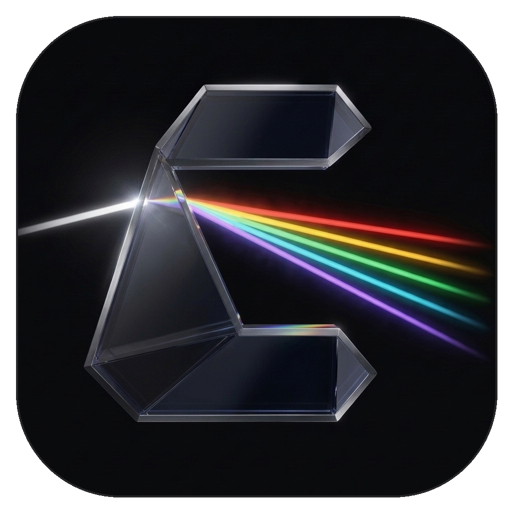

# 传彩笔 CAIBI

<p align="center">
  
</p>

**CAIBI**（**C**hrome **A**sset & **I**mage **B**reakdown **I**nspector），中文名**传彩笔**（典出“江淹梦授五色笔”，寓意化彩为辞、由辞生画），是一款常驻游标的视觉逆向工程与资产编译 Chrome MV3 扩展。

悬停任意网页图片并按 **Alt + 右键**（或 **Alt + Q**，亦可在设置中开启悬浮 `[+]` 徽章），光标旁即刻弹出瑞士黑白机能风 HUD；也可点击扩展图标打开工作台，上传本地图片、拖拽文件或输入图片 URL 进行分析：

1. **0-token 本地物理分析**（纯 Canvas，无外部依赖）：精确提取 K-Means 五色板（`k=5×10` 迭代）Hex 与面积占比并支持点击复制、计算最简整数宽高比与推荐 `--ar` 参数、统计明度直方图（Shadows / Midtones / Highlights + σ 对比度）与光调标签。触发后停留在**手动确认态**，不自动消耗任何 API 额度。
2. **双 Agent 解耦视觉逆向编译**（OpenAI 兼容协议，流式输出）：
   - **Agent 1**（视觉解构）：结合图像与 Canvas 预提取物理元数据，执行零预设穷举列键与空间坐标级填值，输出纯中文结构化 **JSON 提示词**（7 个核心键 + 按画面复杂度动态追加的细分键，完整抄录可见文字）。
   - **Agent 2**（无损压缩）：将 Agent 1 的结构化结果无损压缩为电报式**精简提示词**（固定画幅比例，一字不漏保留可见文字原文）。
   - 工作区支持分阶段流式进度展示、随时取消、内联编辑提示词，以及复制或下载 **Obsidian Markdown** 笔记（含 YAML frontmatter）。
3. **可选生图与全局人物资产库**：在设置中填写可选生图模型后，可在待确认态直接提取 **50/50 人物资产图**或**漫转真人资产图**，也可在工作区基于 JSON 提示词或精简提示词生图，支持统一选择当前原图、本地上传图或人物资产库图片作为垫图（自动兼容 `/images/edits`、`/chat/completions` 多模态/SSE 与 `/images/generations` 端点回退）。
4. **全局 IndexedDB 历史库**：由后台 Service Worker 统一维护扩展域 IndexedDB（`vrc-history`，包含 `records` 与 `assets` 两个对象库），跨站点共享记录；支持关键词与 12 色系筛选、一键恢复历史工作区、单条删除、批量导出 `.md` 与二次确认清空。

## LOGO 光学设计与 AI 垫图美化指南

传彩笔 CAIBI 的图标是一枚严格遵循几何光学公式计算的 **C 型切面棱镜**（C-Prism），用“纯白原图入射 $\to$ 拆解为 5 道色散光谱”呼应 **CAIBI** 首字母与 **K-Means 五色板**：

- **双界面斯涅尔折射 + 柯西色散公式**：由 [generate-icons.py](scripts/generate-icons.py) 在 `1024×1024` 坐标系中按 $n(\lambda) = A + B/\lambda^2$（$A=1.22, B=0.115$）与 $n_1 \sin\theta_1 = n_2(\lambda)\sin\theta_2$ 精确求解入射点 `P1`、棱镜内折转角、出射点 `P2` 与右向 5 束光谱 `P3`：
  - `650nm` 朱红 `#EF4444`（$n=1.492$，偏折最小，居最上）
  - `558nm` 明黄 `#EAB308`（$n=1.589$）
  - `502nm` 翠绿 `#22C55E`（$n=1.676$）
  - `463nm` 青蓝 `#06B6D4`（$n=1.756$）
  - `433nm` 蓝紫 `#8B5CF6`（$n=1.833$，向棱镜底边偏折最大，居最下）
- **重新生成矢量母版与多尺寸扩展图标**：

```bash
python scripts/generate-icons.py
```

脚本会同步产出矢量母版 [logo.svg](assets/logo.svg)、1024px 垫图参考图 [logo-reference-1024.png](assets/logo-reference-1024.png) 以及工具栏小尺寸图标 `src/public/icon-16.png`；最终主图标 [logo-style-b.png](assets/logo-style-b.png)（与极简矢量对照版 [logo-style-a.png](assets/logo-style-a.png)）采用圆角黑曜石底板与透明四角，由 [generate-logo-variants.py](scripts/generate-logo-variants.py) 封装产出并同步至 `src/public/icon-{48,128}.png`。

- **AI 生图垫图美化提示词**（将 [logo-reference-1024.png](assets/logo-reference-1024.png) 作为参考图，也可直接用**传彩笔 CAIBI** 工作区的垫图生图功能生成）：

```text
以参考图的几何构图与光线角度为严格骨架，将其升级为超写实三维黑曜石切面光学晶体图标（1:1 正方形构图）。中央保留锐利切面的字母 C 型深邃烟熏水晶棱镜，晶体边缘带有冷冽的微米级磨砂金属高光倒角与细腻玻璃内部折射质感。左侧一道极细的纯净高能白光斜向上射入 C 型棱镜左壁，在棱镜腔体右侧出射斜面严格按原图角度自上而下依次色散出红、黄、绿、青、紫五道高饱和物理激光光谱，光束穿过 C 型开口向右发散并伴随轻微光学辉光与空气微尘。背景为极简哑光黑曜石微纹理暗底（#09090B），瑞士工业精密仪器美学，无任何文字、水印或多余装饰，高对比度，边缘锐利。
```

## 技术栈

- [WXT](https://wxt.dev) 0.19（Vite 底座，MV3）+ React 18 + TypeScript strict
- Tailwind CSS 3，经 `cssInjectionMode: 'ui'` 注入 **Shadow DOM**（`vrc-hud`），与宿主页面样式完全隔离
- `idb` 封装扩展域全局 IndexedDB（`vrc-history`）；`chrome.storage.local`（`vrc_settings`）存 BYOK 本地设置
- CORS 代理：后台 Service Worker 以 `host_permissions: <all_urls>` 抓图 → `OffscreenCanvas` 压至 ≤1024px（PNG / WebP / GIF 自动保留为 PNG，其余输出 JPEG）→ 返回 base64 Data URL 与原始宽高；长耗时流式编译通过 `chrome.runtime.Port`（`vrc-compile`）+ 保活心跳稳定传输

## 开发与构建

```bash
npm install        # 安装依赖并自动执行 wxt prepare 生成类型
npm run dev        # 开发模式（自动打开浏览器 + HMR）
npm run build      # 生产构建 → .output/chrome-mv3/
npm run zip        # 打包 zip（商店发布用）
npm run typecheck  # tsc --noEmit 全量类型检查
npm run test:e2e   # 启动真实 Chrome 运行 Puppeteer 端到端验收测试
```

## 加载到 Chrome

1. 执行 `npm run build`，生成 `.output/chrome-mv3/`；
2. 打开 `chrome://extensions`，开启右上角**开发者模式**；
3. 点击**加载已解压的扩展程序**，选择 `.output/chrome-mv3` 目录；
4. 悬停图片按 **Alt + 右键** / **Alt + Q**，或右键图片选择**传彩笔 CAIBI · 视觉逆向解剖**，或点击工具栏图标打开工作台；
5. 打开**设置**，填入 OpenAI 兼容 **Base URL**、**API Key** 与必填的**视觉模型名**（支持点击**拉取模型**从 `/models` 自动获取），并按需选配**生图模型**与触发方式。

## 目录结构

```
assets/
├── logo-style-b.png             # 最终主 LOGO（3D 精密光学风 + 圆角透明外框）
├── logo-style-a.png             # 极简几何矢量对照版（+ 圆角透明外框）
├── logo-style-a.svg             # 极简几何矢量对照版 SVG
├── logo.svg                     # C 型棱镜物理色散公式矢量母版
└── logo-reference-1024.png      # 1024px 垫图参考母版
scripts/
├── generate-icons.py            # 斯涅尔折射 + 柯西色散图标生成脚本
└── generate-logo-variants.py    # 方向 A 生成与圆角透明外框封装脚本
src/
├── assets/
│   └── content.css              # Tailwind 入口与自定义滚动条样式
├── public/
│   └── icon-{16,48,128}.png     # 多尺寸 LOD 扩展图标
├── entrypoints/
│   ├── background.ts            # CORS 图片代理、contextMenus、Port 流式编译、生图转发与全局 IndexedDB 读写
│   ├── content.tsx              # Shadow DOM HUD 挂载（cssInjectionMode: ui）与生命周期清理
│   └── content/triggers.ts      # Alt+右键 / Alt+Q / 可选悬浮 [+] 徽章触发器
├── components/
│   ├── HudApp.tsx               # HUD 状态机（idle/fetching/physics/confirm/compiling/ready/error）、拖拽与视口钳制
│   ├── HudWorkspace.tsx         # 结果工作区（品类标签、资产提取、共享垫图栏、JSON/精简提示词编辑与 Markdown 导出）
│   ├── ImageGenPanel.tsx        # 可折叠生图面板（生图触发、预览放大、下载与存入人物资产库）
│   ├── PhysicsBar.tsx           # Hard Facts Bar（尺寸、宽高比、--ar、五色板、明度直方图）
│   ├── HistoryDrawer.tsx        # 历史抽屉（解剖记录关键词/色系筛选、批量导出与人物资产库管理）
│   ├── SettingsModal.tsx        # OpenAI 兼容 BYOK 设置、模型拉取与可选生图配置
│   └── ui.tsx                   # CopyButton / PromptBox / SectionLabel / ExtractedAssetPreview 公共组件
├── services/
│   ├── promptSpec.ts            # 双 Agent 解构与无损精简 System Prompt
│   ├── visionCompiler.ts        # OpenAI 兼容流式视觉编译、模型列表拉取、JSON 提取与记录规范化
│   ├── imageGenerator.ts        # OpenAI 兼容生图（edits / chat / generations 多端点回退与 SSE/多模态解析）
│   ├── db.ts                    # IndexedDB（records / assets）CRUD、色系分类与 Obsidian Markdown 导出
│   └── settings.ts              # chrome.storage.local 读写与配置归一化
└── utils/
    ├── imagePhysics.ts          # K-Means 色板、比例化简与明度直方图分析
    ├── base64.ts                # ArrayBuffer 转 Base64 与 Data URL 扩展名推断
    ├── clipboard.ts             # 剪贴板复制与回退
    └── types.ts                 # 领域类型与默认设置
```
